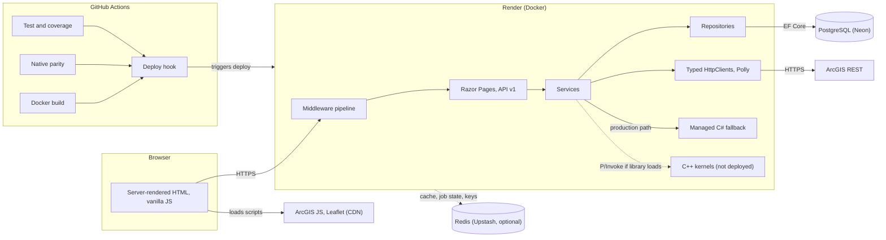

# Brian Patrick Coffey – Software Engineering Portfolio

[](https://github.com/brianpcoffey/gis-portfolio/actions/workflows/ci.yml)
[](https://github.com/brianpcoffey/gis-portfolio/actions/workflows/github-code-scanning/codeql)
[](https://brianpcoffey.com)

A live, full-stack .NET 10 portfolio: 18 interactive demos, mostly GIS and spatial compute, on a layered ASP.NET Core API with PostgreSQL, plus 13 C++ kernels whose benchmarks are published in full, losses included.

**Try it:** [All projects](https://brianpcoffey.com/Projects) · [Home Finder](https://brianpcoffey.com/Projects/HomeFinder) · [Route Planner](https://brianpcoffey.com/Projects/Network) · [Fleet Route Optimizer](https://brianpcoffey.com/Projects/Fleet) · [US State Explorer](https://brianpcoffey.com/Projects/StateExplorer) · [API reference (Scalar)](https://brianpcoffey.com/scalar)

## At a glance

- **Live site.** A .NET 10 Razor Pages app and a versioned JSON API (`/api/v1/...`, documented with OpenAPI and a [Scalar](https://brianpcoffey.com/scalar) reference) host 18 interactive demos, each with a demo page and a technical Details page.
- **Layered architecture.** Razor Pages and controllers call service interfaces, which call repository interfaces over EF Core and PostgreSQL. ArcGIS is reached through typed `HttpClient`s with Polly timeout, retry and circuit-breaker policies. See [Solution Architecture](#solution-architecture).
- **CI gates.** Every push and pull request to `main` runs a format check, a warnings-as-errors build with a complexity gate, the tests with ratcheting coverage floors, a native-parity job (all 13 kernels loaded, then native disabled) and a production Docker build. Render deploys only after those pass. CodeQL (GitHub default setup), dependency review on PRs and a weekly vulnerable-package sweep run alongside.
- **13 C++ kernels with managed fallbacks.** Each kernel is a C++20 library behind P/Invoke, with a managed C# fallback whose results are checksum-compared against it on every benchmark workload. Measured against that fallback across 21 workloads, native runs at **0.37× to 2.26×** the managed speed: **9 wins, 5 losses, 7 ties** (win ≥ 1.15×, loss ≤ 0.85×, tie within ±15%). **Production runs the managed paths**; the container image ships no native code. Table and method: [Measured speedup](#measured-speedup).
- **Security and identity.** Security headers on every response, a nonce-based Content-Security-Policy in Report-Only mode beside an enforced baseline policy, per-IP rate limiting plus a shared CPU concurrency limiter on the compute endpoints, and two deliberately separate identity systems (an anonymous cookie identity and Google sign-in) with a single `Authenticated` authorization policy. See [Features](#features).
- **Hosting.** Render (Docker) with PostgreSQL on Neon and optional Redis (Upstash) for cache, batch-job state and Data Protection keys. On Render's free plan the service spins down when idle. A scheduled keep-warm ping keeps it awake from 12:00 to 03:59 UTC; outside that window the first request after a quiet period can take 30-90 seconds ([details](docs/render-deployment.md#cold-starts-and-the-keep-warm-ping)). Azure, AKS and Azure Container Apps are future targets, not current dependencies.

---

## Overview

A .NET 10 Razor Pages and ASP.NET Core API portfolio focused on scalable backend engineering, GIS workflows, geocoding services, user-scoped persistence, and cloud-ready deployment patterns. The application is intentionally structured as a lead-level system design walkthrough: thin Razor/API entry points, service-layer business logic, repository-owned data access, typed external integrations, cache-backed geocoding workflows, and containerized deployment assets.

The current production deployment runs on **Render** with **PostgreSQL via Npgsql/EF Core**. The repository also includes a multi-stage Dockerfile, Docker Compose with Redis, and Kubernetes manifests that demonstrate how the same architecture can move to a horizontally scaled container platform. Azure, AKS, Azure Container Apps, or Azure Cache for Redis are future hosting targets rather than current production dependencies.

---

## Solution Architecture

The solution follows a classic 4-layer architecture across 6 projects:

```
Razor Page / API Controller  (Portfolio.Web)
        │
        ▼
   Service (interface)       (Portfolio.Services)  ──▶ typed HttpClient ──▶ ArcGIS REST
        │
        ▼
 Repository (interface)      (Portfolio.Repositories)
        │
        ▼
  PortfolioDbContext (EF Core) ──▶ PostgreSQL
```

| Project | Role |
|---|---|
| `Portfolio.Web` | ASP.NET Core host: Razor Pages + API controllers + middleware + the DI root (`Program.cs` composes the extension methods in `Startup/`) |
| `Portfolio.Services` | Business logic, orchestration, ArcGIS HTTP calls |
| `Portfolio.Repositories` | EF Core `DbContext`, repositories, fluent mappings, migrations |
| `Portfolio.Common` | POCO entity models, DTOs, enums, and ArcGIS wire models |
| `Portfolio.Tests` | xUnit + Moq tests: unit tests for services and controllers, golden and contract tests, and in-process host tests of the real pipeline |
| `Portfolio.Benchmarks` | Console harness that times each native kernel against its managed fallback and checksums both results |

**Runtime and delivery.** Solid arrows are the normal flow; dashed arrows are optional or not deployed.



The P/Invoke bridges ship in the image, but the C++ libraries are built only in the CI native-parity job and on a developer machine, so the deployed service always takes the managed path. Redis is optional: without `Redis:ConnectionString` the app uses in-memory caches and job state.

---

## Native Spatial Compute Architecture

This portfolio uses a native-kernel pattern for compute-heavy spatial workflows. ASP.NET Core owns the product/API layer, C# services validate inputs and map DTOs, and native C++20 libraries expose stable C ABIs consumed through P/Invoke. Every native-backed workflow stays portable: `IsAvailable` gates the native path, and a managed C# fallback preserves functionality when the shared library is absent.

Thirteen kernels are implemented, each with C++ source, a P/Invoke bridge, and a managed fallback:

| Project | Native library | Native role |
|---|---|---|
| Redlands Smart Home Finder | `portfolio_scoring` | weighted property scoring over a contiguous batch |
| Live Location Stream | `geostream_processor` | telemetry parsing, filtering, grid aggregation, anomaly detection |
| Geometry Toolkit | `spatial_geometry_kernel` | fan triangulation and Sutherland–Hodgman polygon clipping |
| Terrain Analyzer | `raster_terrain_kernel` | hillshade, slope/aspect, and Gaussian heatmap over dense grids |
| Route Planner | `spatial_graph_engine` | Dijkstra/A\* shortest path, service areas, and cost matrices over a CSR graph |
| Hotspot Clusterer | `spatial_cluster_kernel` | DBSCAN density clustering over contiguous points |
| Viewshed Analyzer | `viewshed_kernel` | line-of-sight ray casting over elevation grids |
| Spatial Overlay / Zone Tagger | `spatial_overlay_kernel` | point-in-polygon spatial join over a flat zone-vertex buffer |
| Catastrophe Risk Analyzer | `cat_risk_kernel` | ring accumulation and Monte Carlo event-loss simulation |
| Raster Change Detection | `change_detection_kernel` | CVA magnitude, Otsu threshold, morphology, connected components |
| Outage Manager | `network_trace_kernel` | fault tracing, isolation search, and connectivity sweeps over CSR incidence |
| Response Coverage Optimizer | `facility_location_kernel` | p-median greedy seeding plus Teitz–Bart substitution |
| Fleet Route Optimizer | `vrp_solver_kernel` | CVRPTW — Clarke-Wright savings plus 2-opt / Or-opt local search |

### Is any of it actually faster?

Mostly no — and the repository says so. `Portfolio.Benchmarks` measures all thirteen against their own managed fallbacks in a single command, comparing a checksum from each path alongside the timings.

Across 21 workloads: **9 are a clear win (≥ 1.15×), 5 a clear loss (≤ 0.85×), and 7 land within ±15% — indistinguishable.** The full range is 0.37× to 2.26×.

| | Workload | Speedup |
|---|---|---:|
| Fastest | `vrp_solver_kernel` — CVRPTW, 120 stops | **2.26×** |
| | `spatial_overlay_kernel` — point-in-polygon join | **1.90×** |
| Slowest | `spatial_geometry_kernel` — fan triangulation | **0.37×** |
| | `geostream_processor` — telemetry aggregation | **0.41×** |

Native wins where the inner loop is flat, branch-free, and allocation-free, and where the work is large relative to the number of P/Invoke crossings. It loses where marshalling dominates — fan triangulation's "computation" is three index assignments per triangle, so copying the array in and out saves nothing. `portfolio_scoring` measures 0.99× **despite genuinely compiling with `/arch:AVX2`**: setting the flag is not the same as being vectorised.

**Three kernels were slower than the C# they were written to replace**, all for the same reason — allocation or hashing in the hot loop. `network_trace_kernel` was 2.5× slower with an `unordered_map` adjacency; `vrp_solver_kernel` 1.7× slower allocating a vector per candidate move; `spatial_graph_engine` lost on every workload with `std::map`. CSR layouts and hoisted buffers turned all three around. Writing C++ is not a performance strategy — controlling memory layout, allocation, and boundary crossings is, and all three are available in both languages.

**The parity check earned its keep.** Comparing checksums caught two real native defects that every earlier ad-hoc benchmark had missed: a bounding-box clip that clamped vertices instead of clipping the polygon, and a viewshed ray walk whose rounding disagreed with the managed path at exactly `.5`. Both are fixed, and `NativeParityTests` now locks the contracts — verified to fail against the pre-fix kernels rather than passing vacuously.

> **Production deliberately runs the managed fallback for all thirteen.** The container build compiles no native code and the UI correctly reports "Native: No". For a coin-flip speedup, shipping the kernels would cost a C++ toolchain in the build image, compile time on every deploy, and a second binary per kernel that can silently diverge from the managed one — which two of them did. The kernels earn their place as an interop and architecture demonstration with a verified-identical fallback, not as a deployment dependency.

The complete results, methodology, superseded figures, build steps and the cost of shipping natively follow.

### Measured speedup

All thirteen kernels are measured by `Portfolio.Benchmarks`, a console harness in this
solution. It runs itself twice as a child process — once with `PORTFOLIO_DISABLE_NATIVE=0`
and once with `=1` — because each bridge probes its shared library exactly once in a static
constructor, so a single process can only ever measure one path.

**Methodology.** 3 warmup iterations discarded, then 9 timed iterations, reporting the
**median** with min and max alongside it. Both children are pinned to one performance core at
high priority. Every workload folds its result into a deterministic checksum, and the two
paths' checksums are compared; a row whose checksums disagree is a correctness defect and its
speedup means nothing.

Measured on 20 logical cores, .NET 10.0.9, Windows 11 (the two rows marked † were re-measured later, on
.NET 10.0.12; see the reading notes):

| Kernel | Workload | Native median | Managed median | Speedup | Native min–max | Managed min–max | Parity |
|---|---|---:|---:|---:|---:|---:|---|
| `portfolio_scoring` | weighted scoring, 200,000 properties, top 50 | 108 ms | 107 ms | 0.99x | 98.4 ms–112 ms | 79.3 ms–117 ms | exact |
| `geostream_processor` † | parse + filter + grid aggregate, 40 x 10,000 events | 80.4 ms | 33.1 ms | 0.41x | 65.4 ms–103 ms | 31.2 ms–113 ms | exact |
| `spatial_geometry_kernel` | fan triangulation, 400 x 5,000 vertices | 188 ms | 70.2 ms | 0.37x | 170 ms–192 ms | 66.0 ms–86.4 ms | exact |
| `spatial_geometry_kernel` | bounding-box clip, 400 x 5,000-vertex polygon | 81.5 ms | 62.5 ms | 0.77x | 75.4 ms–93.3 ms | 61.1 ms–63.1 ms | exact |
| `raster_terrain_kernel` | hillshade, 20 x 500x500 elevation grid | 196 ms | 164 ms | 0.83x | 183 ms–202 ms | 156 ms–185 ms | exact |
| `raster_terrain_kernel` † | Gaussian heatmap, 2 x 500x500 over 100 points | 218 ms | 278 ms | **1.28x** | 215 ms–230 ms | 275 ms–293 ms | exact |
| `spatial_graph_engine` | one-to-all Dijkstra, 40 x (2,530 nodes / 3,187 edges) | 33.2 ms | 15.0 ms | 0.45x | 27.1 ms–48.2 ms | 12.2 ms–46.3 ms | exact |
| `spatial_graph_engine` | 40x40 cost matrix over the same network, 10 builds | 63.1 ms | 82.9 ms | **1.31x** | 62.2 ms–71.7 ms | 82.4 ms–89.7 ms | exact |
| `spatial_cluster_kernel` | DBSCAN, 8 x 5,000 points, eps 0.16 / minPts 6 | 186 ms | 175 ms | 0.94x | 183 ms–191 ms | 165 ms–182 ms | exact |
| `viewshed_kernel` | line-of-sight viewshed, 3 x 500x500 grid | 232 ms | 227 ms | 0.98x | 223 ms–243 ms | 226 ms–229 ms | exact |
| `spatial_overlay_kernel` | point-in-polygon join, 30 x 10,000 points x 48 zones | 156 ms | 297 ms | **1.90x** | 155 ms–169 ms | 295 ms–308 ms | exact |
| `cat_risk_kernel` | ring accumulation, 20 x 900 locations, 3 km | 106 ms | 97.3 ms | 0.92x | 103 ms–110 ms | 96.9 ms–102 ms | exact |
| `cat_risk_kernel` | Monte Carlo loss simulation, 900 x 5,000 events | 49.3 ms | 50.3 ms | **1.02x** | 47.1 ms–55.1 ms | 49.0 ms–54.7 ms | exact |
| `change_detection_kernel` | CVA + Otsu + open + components, 512x512x4 | 15.0 ms | 14.8 ms | 0.99x | 10.2 ms–22.9 ms | 10.3 ms–20.4 ms | exact |
| `network_trace_kernel` | downstream trace sweep, 267 elements x 266 faults | 16.8 ms | 17.0 ms | **1.01x** | 10.6 ms–23.9 ms | 16.5 ms–25.1 ms | exact |
| `network_trace_kernel` | trace + restoration plan, 266 faults | 20.2 ms | 29.8 ms | **1.48x** | 20.0 ms–42.8 ms | 12.1 ms–48.0 ms | exact |
| `facility_location_kernel` | p-median 1,400x64, p=8, weighted mean, 10 solves | 22.7 ms | 34.8 ms | **1.53x** | 21.1 ms–24.8 ms | 34.3 ms–43.4 ms | exact |
| `facility_location_kernel` | p-median 1,400x64, p=8, weighted p90 | 138 ms | 228 ms | **1.66x** | 137 ms–144 ms | 228 ms–229 ms | exact |
| `facility_location_kernel` | shipped scenario 450x24, p=4, p90, 4 solves | 22.4 ms | 38.8 ms | **1.73x** | 22.2 ms–22.8 ms | 38.7 ms–39.4 ms | exact |
| `vrp_solver_kernel` | CVRPTW solve, 120 stops, 10 vehicles, 8 solves | 24.7 ms | 55.9 ms | **2.26x** | 24.1 ms–27.5 ms | 54.1 ms–62.5 ms | exact |
| `vrp_solver_kernel` | CVRPTW solve, shipped "fullday" preset, 40 stops, 30 solves | 10.9 ms | 20.9 ms | **1.92x** | 10.6 ms–11.4 ms | 20.5 ms–23.4 ms | exact |

**Totals and the tie band.** Speedup is the managed median over the native median. Across the 21 workloads native is a clear win (≥ 1.15×) on **9**, a clear loss (≤ 0.85×) on **5**, and within the ±15% tie band — indistinguishable — on **7**; the full range is 0.37×–2.26×. The Parity column reads `exact` on all 21 rows: the two paths' checksums agree.

Reading notes:

- The `p-median` and `CVRPTW` rows time the **solver stage only**, using the duration the
  service itself reports (`SolveMs`). The road-network distance-matrix build that precedes
  them is `spatial_graph_engine` work and would otherwise dominate the row.
- Several workloads are a burst of full-size calls rather than one large call, because the
  services cap their inputs (10,000 telemetry events, 5,000 geometry points, 250,000 raster
  cells, 25,000,000 heatmap cell-point evaluations). Those caps are production guardrails, so
  the per-call marshalling is counted — it is part of what a caller actually pays.
- The Gaussian heatmap row (†) was re-measured on 2026-10-13 after the service gained its
  25,000,000 cell-point request limit. The row it replaces (one call, 500x500 over 200 points,
  1.22x) is a request the service now rejects. The workload is now two calls of 500x500 over 100
  points: the same 50,000,000 cell-point evaluations, but the output is marshalled and normalized
  twice. A second full run measured a noisier managed path (1.54x); the first run, with the
  tighter spread and the lower speedup, is the one published.
- The geostream row (†) was re-measured on 2026-10-13 after the kernel stopped being built with
  `/fp:fast`. The fast-math build compiled the cell-index division as a multiplication by
  `1 / grid`, so a coordinate on a cell boundary could land one cell away from the managed path
  (longitude -128.4 at a 0.1 degree grid: cell 515 managed, 516 native). Three runs of each build,
  alternating: fast-math 0.59x, 0.40x, 0.38x; precise 0.39x, 0.44x, 0.41x (the middle one is
  published). The two builds' native times overlap, so the change itself is not measurable; what
  moved is the managed median (54.9 ms in the earlier 0.59x run, 33.1–34.9 ms in five of these
  six). The row is still a clear loss, and the 9 / 5 / 7 split and the 0.37x–2.26x range are
  unchanged. Every other row is as previously published, measured on .NET 10.0.9.
- `portfolio_scoring` is the only native-backed service whose public entry point reads from a
  repository. The harness supplies a fixed-seed in-memory one; every other kernel runs on an
  in-repo deterministic dataset reached through its public API.
- Where the two spreads overlap, read the row as "no measurable difference" rather than as the
ratio of the medians. The one-to-all Dijkstra row is the clearest case: native spans
27.1–48.2 ms and managed 12.2–46.3 ms, and across runs its managed median has landed anywhere
between 15 ms and 44 ms. That row is dominated by allocation and scheduling noise, not by the
choice of implementation, and no honest speedup can be read off it. It is left in the table
rather than dropped, because a benchmark that only reports the rows that resolve cleanly is
not a benchmark.

#### The parity check found two real bugs — both now fixed

The harness checksums every result and compares the two paths, and on its first run two
workloads disagreed. Neither was a rounding artefact; both were genuine defects in the native
kernels that every previous ad-hoc benchmark had missed, because nothing had ever compared the
two implementations.

- **`spatial_geometry_kernel`, bounding-box clip.** The managed fallback implements
  Sutherland–Hodgman clipping; `Geometry_ClipToBoundingBox` in C++ called `std::clamp` on each
  vertex independently — which is not polygon clipping at all. For a 5,000-vertex star clipped
  to a box, managed returned a 2,549-vertex polygon and native returned 5,000 vertices squashed
  onto the box edges. It never emitted a true edge/box intersection point, never emitted a box
  corner, and returned a degenerate full-size polygon for a subject lying entirely outside the
  box instead of an empty one. The kernel now runs the same Sutherland–Hodgman passes as the
  managed path, in the same order, with the same intersection formulas.
- **`viewshed_kernel`, line-of-sight.** The ray walk rounded sample coordinates with
  `Math.Round` in C# (banker's, half-to-even) and `std::lround` in C++ (half away from zero),
  so any ray whose sample landed exactly on `.5` walked a different cell — 43 cells out of
  250,000 on a 500×500 grid. Both sides now use an explicit half-up rule rather than relying on
  either language's default.

All twenty-one workloads now agree exactly. `Portfolio.Tests/Services/NativeParityTests.cs`
locks both contracts: those tests drive the native kernels directly, no-op when the shared
libraries are absent, and were confirmed to fail against the pre-fix kernel rather than passing
vacuously.

The wider lesson is about test design, not C++. The managed contract was thoroughly tested —
including a test asserting that clipping emits the box corner that naive clamping drops — and
the native kernel violated it for as long as it existed, because every test drove the service,
and the service prefers native only when a shared library is present, which in CI it never is.

#### Superseded numbers

Earlier revisions of the native documentation published single timed runs after one warmup, measured ad hoc
and by different methods per kernel. Those figures are withdrawn in favour of the table above.
Best-of-N and single-shot both reward a lucky run, and they systematically flatter whichever
path has the higher variance — the previously published 1.66× for `spatial_graph_engine` was
exactly that artifact. Where the new data disagrees with the old, the new number stands:
`facility_location_kernel` weighted mean 2.23× → 1.53×, `spatial_graph_engine` Dijkstra
1.66× → 0.45× (a noise-dominated row, see above), `change_detection_kernel` pipeline 1.24× → 0.99×, and
`cat_risk_kernel` ring accumulation 1.09× → **0.92×**, which reverses the direction of the result. The 0.87× figure
for a 4,603-element trace could not be reproduced at all: no public API yields a network that
size, and the shipped one has 267 elements.

#### Running the benchmarks

```powershell
dotnet run --project Portfolio.Benchmarks -c Release
```

That is the whole thing. The command builds both children, runs every workload on both paths,
and prints the markdown table above plus the parity verdict. It takes a few minutes.

The benchmark project copies the built kernels out of `Portfolio.Services/bin/Debug/net10.0`
into its own output directory, so build the native libraries first (see [Building the kernels](#building-the-kernels)) — otherwise the
"native" child silently runs managed code and every row reads 1.00×. The harness reports which
workloads that happened to.

`--run` executes the workloads in the current process and emits JSON only; the parent uses it
for the two children, and it is also how you measure one path by hand:

```powershell
$env:PORTFOLIO_DISABLE_NATIVE = "1"; dotnet run --project Portfolio.Benchmarks -c Release -- --run
```

`--diag` prints the raw results behind the parity checksums for the workloads that disagree,
so a mismatch can be diffed rather than guessed at.

`Portfolio.Benchmarks` is deliberately outside the test suite and outside CI: it is a
measurement tool, and a timing assertion in CI is a flaky test waiting to happen.

### Building the kernels

Each kernel is an independent CMake project (there is no top-level `native/CMakeLists.txt`), so it is configured and built from its own directory. Requirements: CMake 3.25 or newer, and a C++20 compiler — MSVC from VS 2022 17.x on Windows, GCC 12 or Clang 15 on Linux and macOS. A kernel directory holds `CMakeLists.txt`, `include/<kernel>.h` (the exported C ABI — keep it in sync with the matching `NativeInterop`/`NativeStructs` in `Portfolio.Services`) and `src/<kernel>.cpp` (`portfolio_scoring`'s source is `scoring_kernel.cpp`).

**Windows (Visual Studio)** — from the repo root, example: the scoring kernel:

```powershell
cmake -B build/native/portfolio_scoring -S native/portfolio_scoring -G "Visual Studio 17 2022" -A x64
cmake --build build/native/portfolio_scoring --config Release
```

The post-build step copies the built library (e.g. `portfolio_scoring.dll`) into **two** directories: `DOTNET_OUTPUT_DIR` (default `Portfolio.Services/bin/Debug/net10.0/`, where `Portfolio.Services` itself resolves the library) and `WEB_OUTPUT_DIR` (default `Portfolio.Web/bin/Debug/net10.0/`, where the ASP.NET host actually loads from at runtime). Both are needed: the bridges probe `DllImportSearchPath.AssemblyDirectory`, which at runtime is the *web host's* output directory, so copying only to `Portfolio.Services/bin` builds cleanly and still leaves every page reporting "Native: No". `Portfolio.Tests` is deliberately not a copy target — a default test run exercises the managed fallback, and the CI `native-parity` job stages the built kernels into the test output itself. To target another directory (e.g. a publish folder), pass `-DDOTNET_OUTPUT_DIR="Portfolio.Web\bin\Release\net10.0\publish"` to the configure step.

**Linux / macOS:**

```bash
cmake -B build/native/portfolio_scoring -S native/portfolio_scoring -DCMAKE_BUILD_TYPE=Release
cmake --build build/native/portfolio_scoring
cp build/native/portfolio_scoring/portfolio_scoring.so Portfolio.Services/bin/Debug/net10.0/
```

Swap `portfolio_scoring` for any other directory under `native/` to build the rest (the CI `native-parity` job loops over all thirteen). Each bridge calls `NativeLibrary.TryLoad("<kernel_name>")`; the runtime resolves the library first from the directory containing `Portfolio.Services.dll` (`DllImportSearchPath.AssemblyDirectory`), then from the standard OS library paths. If a library is not found the bridge logs a warning and the service falls back to its managed C# implementation, so any subset of the kernels can be built and shipped.

**After pulling a change to a kernel's C ABI, rebuild all kernels** (or delete the copies under `Portfolio.Services/bin` and `Portfolio.Web/bin`, and wherever else you staged them). A kernel whose exported signatures change keeps its export names, so an old build would still load and be called with the new argument list. The kernels whose ABI has changed therefore export a version function — `Viewshed_AbiVersion`, `Raster_AbiVersion` and `Scoring_AbiVersion`, all returning 2 (the `*_ABI_VERSION` macro in the kernel's header, mirrored by `ExpectedAbiVersion` in `Portfolio.Services/Native/*NativeInterop.cs`) — and the bridge refuses a library that reports another version or none: it logs a warning naming the library and the service runs its managed path. That makes a stale library harmless; it does not make it work. When you change an exported signature or struct layout, bump the version in the header and the interop file together, and give the kernel a version function if it has none yet.

### What shipping natively would require

The repository `Dockerfile` deliberately does not ship the kernels: it contains no CMake stage and copies no native libraries, so every kernel runs its managed fallback in the deployed container and the UI correctly reports "Native: No". That is a decision taken on the measurements above, not an omission. Native wins 9 of the 21 workloads (at a ±15% threshold), loses 5, and is indistinguishable on 7. Shipping it would mean compiling thirteen CMake projects on every deploy, carrying a C++ toolchain in the build image, and maintaining a second binary per kernel that can silently diverge from the managed one — which two of them did, until the parity check caught it. That is a real cost for a coin-flip speedup.

If a workload ever justifies it, add a CMake build stage to the `Dockerfile` and one copy line per kernel after the `dotnet publish` stage, for example `COPY --from=build /src/build/native/vrp_solver_kernel/vrp_solver_kernel.so /app/publish/`. The candidates would be the kernels that actually win — `vrp_solver_kernel` (2.26×), `spatial_overlay_kernel` (1.90×) and `facility_location_kernel` (1.73×) — and even then only if the request volume made the difference matter.

---

## Features

### Authentication & Identity
- **Google OAuth 2.0 Sign-In** — secure login using Google accounts
- Cookie authentication: 8-hour sliding expiry with a 24-hour absolute cap, `Secure` outside Development, `SameSite=Lax`
- **Anonymous user identity** — browser visitors are silently assigned a GUID cookie (`AnonUserId`) by middleware (throttled per client address, never created for `/api` calls), enabling per-user saved features and profile claims without requiring sign-in
- Two parallel identity systems: anonymous (GUID cookie) and authenticated (Google OAuth), each used by distinct services
- Sign-out with smooth redirection; login/logout paths at `/Login` and `/Logout`

### UI & UX
- Fully responsive design with Bootstrap 5
- Dark/light mode toggle with preference persistence
- Profile avatar dropdown with compact logout menu
- Card-based project showcase with icons, stack badges, and demo links
- Font Awesome icons throughout

### API & Backend
- Versioned RESTful JSON API controllers under `api/v1/` using `Asp.Versioning`
- OpenAPI document generation via ASP.NET Core OpenAPI, with Scalar as the interactive API reference UI (served in all environments)
- Structured logging with `ILogger<T>`; user ids appear in logs only as a short non-reversible tag
- `ApiExceptionMiddleware` for centralized RFC 7807 error handling, plus exception filters that keep the `{ "error": "…" }` 400 body and turn an open ArcGIS circuit breaker into a 503 with a retry hint
- Per-IP rate limiting (a global limit plus `compute` and `expensive` policies) and one shared concurrency limiter for the native-compute endpoints
- Security headers, with a nonce-based Content-Security-Policy running in Report-Only mode alongside the enforced baseline policy (violations go to a rate-limited `/csp-report` sink)
- All async methods accept and forward `CancellationToken`
- Redis-backed `IDistributedCache` shared across geocoding services for deduplication and result caching, with in-memory fallback when `Redis:ConnectionString` is empty
- Redis-backed batch job state through `RedisBatchJobStore`, allowing any replica to serve async geocoding status requests
- Redis-backed ASP.NET Core Data Protection keys in production so encrypted cookies and antiforgery tokens remain valid across replicas
- Typed `HttpClient` registrations with Polly timeout, retry, jitter, and circuit breaker policies for ArcGIS dependencies
- EF Core migrations run at startup via `db.Database.Migrate()` by default; a deployment can instead run them as a separate step with `dotnet Portfolio.Web.dll --migrate` (see [Deployment](#deployment))

---

## Projects Highlighted

### 🗺️ US State Explorer
Interactive ArcGIS feature exploration with anonymous saved-feature persistence and authenticated collections. The browser handles map rendering, while versioned APIs manage ArcGIS proxying, saved-feature ownership, collection CRUD, and user-scoped PostgreSQL queries.

- ArcGIS JavaScript map experience backed by ASP.NET Core API endpoints
- Anonymous GUID identity for saved features and authenticated identity for collections
- Repository-owned EF Core queries with owner filtering

**Stack:** ArcGIS JS API, ASP.NET Core, PostgreSQL

**API:** `GET /api/v1/features`, `/api/v1/features/saved`, `/api/v1/collections`

---

### 🏠 Redlands Smart Home Finder
Property scoring API that ranks Redlands homes using weighted preferences and stores named searches per user. The scoring service is isolated from controller and repository concerns so the ranking algorithm can evolve without changing the API surface. A native C++ kernel accelerates the compute-intensive ranking math when the shared library is present; the managed C# fallback activates automatically when it is not.

- Curated dataset of ~45 Redlands homes across five real neighborhoods (South Redlands historic, hillside/view, downtown/University, North Redlands, and East Redlands tracts), each with realistic coordinates, pricing, and Redfin/Zillow-style listing features (property type, garage, pool, stories, year built, price/sqft, HOA, days on market, school rating, and brokerage), seeded deterministically via `RedlandsPropertySeedData` and shipped through an EF Core migration
- Preference-based scoring for property search and comparison workflows using a ten-dimension weighted model
- Native C++ scoring kernel (`portfolio_scoring`), called via P/Invoke from `NativeScoringBridge`. It is genuinely compiled with `/arch:AVX2` (MSVC) and `-O3 -march=haswell` (GCC/Clang) — and **benchmarks at 0.99× against the managed fallback on 200,000 properties**, so either the compiler declined to vectorise the loop or the memory traffic dominates. The flags are kept and the number published alongside them: enabling AVX2 is not the same as being vectorised
- Transparent managed fallback: `NativeScoringBridge.IsAvailable` gates the native path; identical C# helpers execute otherwise
- Saved-search CRUD with user-scoped persistence
- Repository abstraction that can evolve toward spatial indexes or search services

**Stack:** ArcGIS JS API, ASP.NET Core, PostgreSQL, C++20/CMake, P/Invoke

**API:** `POST /api/v1/homefinder/search`, `GET /api/v1/homefinder/property/{id}`, `/api/v1/homefinder/searches` (the earlier `score` / `properties/{id}` paths remain as deprecated aliases)

---

### 🗂️ Batch Geocoding
CSV address upload workflow that geocodes records through ArcGIS `findAddressCandidates`. The job API returns `202 Accepted` with a polling URL, while distributed job state allows scaled replicas to serve status requests. The demo page itself posts to the synchronous endpoint and renders the response.

- Jobs enter a bounded in-process queue (capacity 8) drained by a hosted service with two workers; a full queue answers `503` with `Retry-After` instead of piling up work. Uploads are capped at 2 MB and 1,000 data rows
- Channel-based producer/consumer pipeline inside each job, with configurable concurrency
- `IDistributedCache` deduplication for repeated addresses and reduced ArcGIS calls
- Redis-backed or in-memory `IBatchJobStore` depending on environment configuration

**Stack:** ArcGIS, C#, .NET, Channels

**API:** `POST /api/v1/geocoding/batch`, `GET /api/v1/geocoding/batch/{jobId}/status`; the demo page uses `POST /api/v1/geocoding/batch/sync` (hidden from OpenAPI)

---

### 📍 Reverse Geocoding
Interactive map workflow that resolves a clicked or manually entered coordinate into a street address. The service validates coordinate bounds, normalizes cache keys, and calls ArcGIS only when a cached result is unavailable.

- Coordinate grid-snapping so nearby lookups share cached results
- Sliding-expiration `IDistributedCache` for repeated coordinate lookups
- Typed ArcGIS reverse-geocode integration with service-level validation

**Stack:** ArcGIS, C#, .NET, Maps

**API:** `GET /api/v1/geocoding/reverse?lat={lat}&lng={lng}`

---

### 🪪 Address Standardization & Validation
Freeform address parsing and validation workflow that turns user-entered addresses into structured components, then scores the standardized result against ArcGIS geocoding.

- Regex-based parsing for house number, street, unit, city, state, and ZIP components
- Street-suffix normalization and standardized-address formatting
- ArcGIS validation mapped to `ConfidenceTier` values for downstream decision-making

**Stack:** ArcGIS, Address Parsing, C#, .NET

**API:** `POST /api/v1/addresses/parse`, `POST /api/v1/addresses/validate`

---

### 🏭 Plant Operations Dashboard
Authenticated operations dashboard for fiber orders, materials, shipments, and KPI aggregation. Domain services enforce user identity, while repositories handle EF Core owner filtering and PostgreSQL persistence.

- CRUD workflows for orders, materials, and shipments (clients exist as seeded reference data; there is no client CRUD endpoint)
- Dashboard aggregation for revenue, open orders, active shipments, and inventory alerts
- User-scoped service and repository boundaries for authenticated operations data

**Stack:** ASP.NET Core, DataTables, Esri GIS, PostgreSQL

**API:** `/api/v1/fiber/orders`, `/api/v1/fiber/materials`, `/api/v1/fiber/shipments`, `/api/v1/fiber/dashboard/stats`

---

### 📡 Live Location Stream
GPS-style telemetry batch processing pipeline that reduces high-volume sensor or vehicle events into spatial grid aggregates, speed metrics, and anomaly counts for a live-feed style GIS dashboard. A native C++ kernel handles the numeric loops when the shared library is present; the managed fallback activates automatically when it is not. **Measured at 0.41× — the second-slowest of the 21 workloads** (only geometry fan triangulation, at 0.37×, is slower), because the service caps a batch at 10,000 events, so the per-call marshalling is paid far more often than the aggregation work amortises it.

- Channel-oriented GPS event batching with configurable grid size and anomaly threshold
- Native C++ telemetry kernel (`geostream_processor`) processes contiguous event arrays via a stable C ABI
- Aggregate output shaped for ArcGIS JS rendering as point, grid, heatmap, or feature-layer graphics
- Stateless request/response MVP — no per-user persistence; future evolution paths include Redis-backed windows and SignalR live updates

**Stack:** ASP.NET Core, C++20/CMake, P/Invoke, ArcGIS JS API

**API:** `POST /api/v1/geostream/events`

---

### 🔷 Geometry Toolkit
Computational geometry API that transforms map-drawn coordinates into derived geometry ready for GIS visualization and downstream analysis. The architecture establishes the API and native bridge boundary for future robust algorithms; the current MVP implements fan triangulation and bounding-box clipping.

- SVG workbench frontend for point input, operation selection, and result rendering
- Native C++ geometry kernel (`spatial_geometry_kernel`) exposing `Geometry_TriangulateFan` and `Geometry_ClipToBoundingBox` through a stable C ABI
- C# owns preallocated output buffers; native code fills them without cross-runtime allocation
- Foundation for future Delaunay triangulation, Voronoi generation, polygon intersection, and topology validation with GEOS, CGAL, or Clipper2

**Stack:** ASP.NET Core, C++20/CMake, P/Invoke, SVG

**API:** `POST /api/v1/geometry/triangulate`, `POST /api/v1/geometry/clip`

---

### ⛰️ Terrain Analyzer
Raster terrain analysis API that generates hillshade and heatmap outputs from dense numeric grid inputs and renders the results as a browser-visible raster grid. The native C++ kernel processes dense arrays when available; the managed fallback computes slope/aspect and Gaussian-style kernel weights in C#. **Measured split: the Gaussian heatmap runs 1.28× faster natively, hillshade 0.83× — slower.** Same kernel, same grid size; the heatmap loop is flat arithmetic over every cell while hillshade pays a 250,000-element `ToArray()` before touching a pixel.

- Hillshade computation from configurable sun azimuth/altitude and per-cell slope/aspect approximation
- Gaussian-style heatmap kernel from weighted point samples over a target raster extent
- Native C++ raster kernel (`raster_terrain_kernel`) exposing `Raster_GenerateHillshade` and `Raster_GenerateHeatmap`
- Stateless per-request processing; future evolution paths include PNG tile generation, GeoTIFF/COG ingestion, and Redis tile caching

**Stack:** ASP.NET Core, C++20/CMake, P/Invoke

**API:** `POST /api/v1/raster/hillshade`, `POST /api/v1/raster/heatmap`

---

### 🗺️ Route Planner
Spatial graph routing API that computes shortest paths and service areas over a ~2,500-node / ~3,190-edge Redlands road network built from real OpenStreetMap data, rendered on a real Leaflet/OpenStreetMap map. Every node is an actual OSM point with true coordinates — real intersections plus curve vertices chosen by deviation-bounded (Douglas–Peucker) simplification, so no edge strays more than ~4 m from the true road — meaning both the network and computed routes trace the real shape of streets, ramps, and freeway curves on the base tiles. Coverage is dense across downtown Redlands and the area around Esri HQ. Supports Dijkstra and A* with a haversine heuristic; the native C++ engine accelerates Dijkstra when the shared library is present, while A* runs managed-only so the heuristic has full access to node coordinates at query time.

- **Dijkstra and A\*** algorithm selection via UI toggle; A* uses haversine great-circle distance as an admissible heuristic and explores measurably fewer nodes on typical road layouts
- Route metrics surfaced per request: `ExploredNodes`, `DistanceKm` (haversine sum along path), `EstimatedMinutes` (distance ÷ 40 km/h average road speed), and `AlgorithmUsed`
- ~2,500-node / ~3,190-edge Redlands road network (`RedlandsRoadNetwork`) generated from a dense OpenStreetMap extract (arterials down to residential/local streets) covering downtown Redlands and the area around Esri HQ: real intersections plus curve vertices selected by deviation-bounded Douglas–Peucker simplification (no edge strays more than ~4 m from the true road, so surface streets, on/off ramps, and freeway curves all follow their real geometry), reduced to the largest component reachable to Esri HQ (so every origin routes), with Esri HQ placed at its true campus coordinate as the fixed destination
- **Search-space visualization** — the API returns every node each algorithm settled (`ExploredNodeIds`); the map paints A*'s tight beam (teal) against Dijkstra's full flood (amber), making the efficiency difference visible, not just a number
- **Click-anywhere-to-snap** origin selection (nearest-intersection snapping), a junction-only origin picker, and canvas rendering for a smooth 3,000-edge map
- Leaflet 1.9 map on OpenStreetMap tiles with curved edge/route polylines, clickable `L.circleMarker` junctions, blue route polyline, amber service-area highlighting, and map auto-fit to route bounds
- Client fetches full `RoadGraphDto` once via `GET /api/v1/network/graph` and submits it with each route request, keeping the API stateless
- Native C++ routing engine (`spatial_graph_engine`) exposing `Graph_FindShortestPath` and `Graph_ComputeServiceArea`; managed fallback runs `PriorityQueue<TElement, TPriority>`-based Dijkstra/A* automatically when the library is absent
- Turn-by-turn panel with human-readable street-intersection labels; `ExploredNodes` metric drives interviewer discussion of graph search theory

**Stack:** ASP.NET Core, C++20/CMake, P/Invoke, Leaflet 1.9, OpenStreetMap

**API:** `GET /api/v1/network/graph`, `POST /api/v1/network/route`, `POST /api/v1/network/service-area`

---

### 🔥 Hotspot Clusterer
Density-based clustering API that groups spatial points into hotspots with DBSCAN and separates genuine clusters from scattered noise. Unlike k-means, DBSCAN discovers the number of clusters from the data and handles arbitrary cluster shapes, making it a natural fit for incident, complaint, and sensor-anomaly hotspot analysis. A native C++ kernel runs the neighbor-query distance loop when the shared library is present; the managed C# fallback reproduces the identical algorithm otherwise. **Measured at 0.94× — native is marginally slower**, and the two spreads overlap, so the honest reading is that there is no difference to find here.

- DBSCAN with configurable `epsilon` (neighborhood radius) and `minPoints` (density threshold), returning per-point cluster labels (-1 = noise), cluster sizes, and a noise tally
- Border-point reclamation preserved identically across the native and managed paths for numeric parity
- Native C++ clustering kernel (`spatial_cluster_kernel`) exposing `Cluster_RunDbscan` over a contiguous point buffer and a preallocated label buffer
- Self-contained SVG cluster map with a per-cluster legend; no map-tile dependency

**Stack:** ASP.NET Core, C++20/CMake, P/Invoke, SVG

**API:** `POST /api/v1/clustering/dbscan`

---

### 👁️ Viewshed Analyzer
Line-of-sight analysis API that computes the viewshed — the set of terrain cells visible from an observer — over a dense elevation grid, then renders it as an interactive visibility map. Line-of-sight drives real siting decisions for cell towers, radar, wildfire lookouts, and scenic real estate. A native C++ ray-casting kernel handles the per-cell ray walk when the shared library is present; the managed fallback mirrors the same logic.

- Ray-casting viewshed that tracks the maximum vertical angle to intervening terrain, with configurable observer height that materially changes coverage
- Click-any-cell-to-place-observer interaction with an immediate re-computation and coverage KPIs
- Native C++ viewshed kernel (`viewshed_kernel`) exposing `Viewshed_Compute`, returning the visible-cell count and a row-major visibility grid
- Stateless per-request processing over generated DEMs; future paths include earth-curvature correction and GeoTIFF/COG ingestion

**Stack:** ASP.NET Core, C++20/CMake, P/Invoke

**API:** `POST /api/v1/viewshed/compute`

---

### 🧩 Spatial Overlay / Zone Tagger
Point-in-polygon spatial join API that tags each point with the zone that contains it and rolls the results up into per-zone counts (a live choropleth). Spatial join is the workhorse of GIS analysis — which sales territory, census tract, flood zone, or precinct does each record fall in. A native C++ kernel runs the even-odd crossing-number test over a flat zone-vertex buffer when the shared library is present; the managed fallback reproduces the identical test.

- Even-odd ray-casting containment with deterministic first-match assignment when zones overlap
- Flat vertex ABI — all zone rings packed into one contiguous buffer plus a per-zone ring-size array — keeping P/Invoke marshalling cheap
- Native C++ overlay kernel (`spatial_overlay_kernel`) exposing `Overlay_AssignPointsToZones`, returning per-point zone indices and the assigned-point count
- Self-contained SVG choropleth shaded by point density with a per-zone count table

**Stack:** ASP.NET Core, C++20/CMake, P/Invoke, SVG

**API:** `POST /api/v1/overlay/spatial-join`

---

### 🔥 Catastrophe Risk Analyzer
Property-insurance catastrophe model for wildfire exposure. Answers the three questions that decide whether a carrier stays solvent: where the hazard is, where the book is concentrated, and what a bad year could cost. Produces the same deliverables a real CAT model does — exposure accumulation, average annual loss, probable maximum loss, and the occurrence exceedance probability curve.

- **Ring accumulation** — for each location, the summed Total Insured Value within a radius, flagging concentration-limit breaches. Brute-force O(n²) haversine with a conservative bounding-box reject that skips the trigonometry when a pair is provably too far apart
- **Monte Carlo event-loss simulation** — a 5,000-event stochastic wildfire catalog against ~900 insured locations (4.5M site-event evaluations). Intensity decays linearly from the epicenter, scales by site hazard, maps through a `1 − e^(−α·i)` vulnerability curve to a mean damage ratio, then applies a percentage deductible and a limit
- **OEP curve, AAL, and PML** — exceedance rate is the summed frequency of every event exceeding a loss level, so sorting by loss and accumulating rate yields the curve directly. Benchmark losses are interpolated log-linearly at 10/25/50/100/250/500 years; PML is the 250-year loss
- Deterministic synthetic book across six San Bernardino / Riverside wildland-urban-interface communities, generated from a fixed-seed LCG with terrain-driven site hazard — no database, no persistence
- **Benchmarked against its own managed fallback, bit-identical results.** Both workloads sit around parity and ring accumulation measures *below* 1.0 — the bounding-box reject short-circuits most iterations, which defeats vectorisation on both sides. Current figures: [benchmark table](#measured-speedup)
- Self-contained SVG throughout — an exposure map (marker size = TIV, colour = site hazard) and a log-scale EP curve, both theme-aware

**Stack:** ASP.NET Core, C++20/CMake, P/Invoke, SVG

**API:** `GET /api/v1/catrisk/book`, `POST /api/v1/catrisk/accumulation`, `POST /api/v1/catrisk/simulate`

---

### 🛰️ Raster Change Detection
Two satellite passes over the same ground, weeks apart — what changed? The classic multitemporal remote-sensing chain, end to end, framed civil-forward: new construction, burn scars, reservoir drawdown, flood extent.

- **Change Vector Analysis** — per-pixel Euclidean magnitude of the spectral difference vector across all bands. Robust to which band carries the change, and to the uniform illumination offset epoch B deliberately carries
- **Otsu automatic threshold** — a 128-bin histogram walked once, maximizing between-class variance `w₀·w₁·(μ₀ − μ₁)²`. No magic number; the threshold visibly moves as sensor noise rises
- **Morphological open** — erode then dilate with a 3×3 structuring element to kill speckle. With `n > 1` iterations that is erode×n *then* dilate×n, one open with an n-scaled element
- **Connected components** — two-pass union-find with path compression over a flat parent array, 8-connectivity, accumulating area, centroid, mean magnitude and bounding box in the second sweep
- **Scored against ground truth** — four changes are planted in the synthetic epoch B (a subdivision, a burn scar, a reservoir drawdown, a solar array), so the page reports "4 of 4 recovered" rather than just drawing a picture
- **Benchmarked against its own managed fallback, bit-identical results.** End to end it lands within noise of the managed path — most of the pipeline short-circuits per pixel — though the per-stage split is more interesting than the total. Current figures: [benchmark table](#measured-speedup)
- Every raster is drawn to a `<canvas>` via `ImageData`, not to 65,536 DOM nodes; a pointer-drag before/after swipe over a false-colour NIR/Red/Green composite, and an SVG histogram with the threshold marked

**Stack:** ASP.NET Core, C++20/CMake, P/Invoke, Canvas, SVG

**API:** `GET /api/v1/change/scene`, `POST /api/v1/change/detect`

---

### ⚡ Outage Manager & Network Trace
Electric distribution outage management — the flagship GIS application in utilities. Answers the three questions a control room needs within a minute of a recloser locking out: who is out, what isolates the fault, and who can be restored by backfeeding from an adjacent feeder.

- **Downstream fault trace** — breadth-first sweep from the faulted element's downstream node, stopping at open devices, yielding the de-energized section and the customers affected
- **Upstream trace and isolation** — one sweep from the substation tags every node with the element that energizes it, so the path back to the breaker falls out in a single pass. Isolation returns the nearest upstream protective device (fuse before recloser before breaker) plus the *frontier* of closed downstream switches — not every switch, which would fragment the feeder and leave nothing for a tie to reach
- **Tie-switch restoration** — a managed search over every normally-open tie, each candidate evaluated by a native connectivity sweep, rejecting any plan that would backfeed into the fault. Emits an ordered switching plan and an estimated SAIDI-minutes-avoided figure
- **Directed storage, undirected energization** — `from`/`to` record nominal radial flow so upstream and downstream have meaning, but a closed tie backfeeds against that direction, so energization is pure connectivity. Tracing it directionally would report a successful backfeed as reaching nobody
- Deterministic synthetic circuit over Redlands: one substation, two radial feeders (267 elements, 2,495 customers), 22 fused laterals, three reclosers, seven sectionalizing switches, one normally-open tie — no database, no persistence
- **Benchmarked against its own managed fallback, byte-identical results** (integer traversal, so the checksums match exactly rather than approximately). The measured gain is modest and run-to-run variance is wide: three P/Invoke calls per trace each re-marshal the whole element array, so marshalling eats more of the gain as the circuit grows. Current figures: [benchmark table](#measured-speedup). The Details page carries the table and the explanation
- Self-contained SVG single-line diagram — click a conductor to fault it, hover any element for its label, device type, state and customer count

**Stack:** ASP.NET Core, C++20/CMake, P/Invoke, SVG

**API:** `GET /api/v1/outage/network`, `POST /api/v1/outage/trace`, `POST /api/v1/outage/restore`

---

### 🚑 Emergency Response Coverage Optimizer
Public-safety deployment analysis over the real Redlands street network. Answers the question a fire chief has to defend in front of a city council — where the stations go — and scores the answer against **NFPA 1710**, the career-department standard of a first-due engine on scene within four minutes of travel time for 90% of incidents.

- **Drive-time isochrones** — not a circle on a map, but graded travel-time bands over the actual road graph. The graph engine's one-to-all pass keeps the per-node cost, which is what banding needs; every reachable node lands in exactly one band and unreachable nodes are counted, not dropped
- **p-median station siting** — greedy seeding followed by Teitz-Bart vertex substitution over a candidate-to-demand travel-time matrix. The substitution loop caches the *nearest* and *second-nearest* open facility per demand point, which turns each of the thousands of swap trials per pass from `O(demand × p)` into `O(demand)`
- **Three objectives that actually diverge** — weighted mean, weighted 90th percentile, and maximum coverage. Switching between them moves the chosen stations, which is the demo: on the shipped scenario at four stations the mean objective picks a different site set than the p90 objective
- **Weighted p90, done correctly** — demand points are ordered by response time and call volume is accumulated until it crosses 90% of the total. It is *not* the p90 of the unweighted list; a single heavy neighbourhood can set it alone, which is exactly what the standard is written to capture
- **Baseline versus optimized, side by side** — today's two stations reach 76.4% of call volume within four minutes and fail NFPA 1710 at a p90 of 4.68 minutes; four optimized stations reach 94.1% at a p90 of 2.42 minutes and pass. That comparison is the whole point of the page
- 450 clustered demand points and 24 candidate sites, all snapped to real network nodes so the matrix has no unreachable pairs; generated from a fixed-seed LCG with no database
- **Benchmarked against its own managed fallback: consistently ~1.5×–1.75×** depending on objective and instance size, with identical chosen stations, assignments, and statistics. The weighted-mean objective gains most (a flat arithmetic loop); the p90 objective spends its time sorting, which compresses the ratio. Current figures: [benchmark table](#measured-speedup)
- Leaflet map with call-volume-scaled demand circles, an assignment starburst that makes the districting legible, clickable isochrone painting, and a theme-aware SVG response-time histogram overlaying today's distribution against the optimized one

**Stack:** ASP.NET Core, C++20/CMake, P/Invoke, Leaflet, SVG

**API:** `GET /api/v1/response/scenario`, `POST /api/v1/response/isochrone`, `POST /api/v1/response/optimize`

---

### 🚚 Fleet Route Optimizer
Last-mile dispatch planning as an actual optimization problem rather than a shortest-path lookup. Given a depot, 40 deliveries with load and delivery windows, and a fleet with a capacity limit and a shift end, it decides which truck serves which stops, in what order, and when each one arrives — the **Capacitated Vehicle Routing Problem with Time Windows**, solved over the real Redlands street network.

- **Clarke-Wright parallel savings construction** — one route per stop, then merge route ends in descending `d(0,i) + d(0,j) − d(i,j)` order while capacity and every time window still hold
- **2-opt and Or-opt local search** — segment reversal within a route and relocation of 1–3 consecutive stops into any position of any route, first-improvement, with the objective recorded after every pass so the convergence curve is real data rather than decoration
- **Time windows that actually bind** — the feasibility walk waits on early arrival and fails on late arrival, and the return leg is checked against the shift end. `ArrivalMinutes` is emitted parallel to `StopIds` so the schedule timeline proves the windows are respected
- **A fixed cost per vehicle** in the objective, which is what makes the solver choose four trucks over five. Three calibrated presets: 2 of 3 vans on loose windows, 4 of 5 trucks on a full day, all 6 trucks once the windows narrow to an hour
- **Real road geometry** — one `(n+1)²` road-distance matrix built server-side, then every solved leg expanded back into a street-following polyline via A*. Distance becomes travel minutes *outside* the graph search, because A*'s haversine heuristic is admissible only while edge costs are kilometres
- Client sends the scenario (~2 KB), not the graph (~425 KB) — deliberately unlike the older Route Planner page
- **Benchmarked against its own managed fallback: ~2.3× at 120 stops, bit-identical solutions — the largest verified win of the thirteen kernels**, and one of the few rows whose spread does not overlap the managed path at all. The first version was 1.7× *slower* until three scratch buffers were hoisted out of the move evaluator; the Details page explains what changed and why there is no SIMD in it. Current figures: [benchmark table](#measured-speedup)

**Stack:** ASP.NET Core, C++20/CMake, P/Invoke, Leaflet, SVG

**API:** `GET /api/v1/fleet/scenario`, `POST /api/v1/fleet/optimize`

---

## Technology Stack


| Layer | Technology |
|---|---|
| Backend | ASP.NET Core 10, C# 14 |
| Frontend | Bootstrap 5, Font Awesome, Vanilla JavaScript, DataTables, D3.js |
| Razor Pages | ASP.NET Core Razor Pages |
| Database | PostgreSQL via Npgsql + EF Core |
| ORM | Entity Framework Core (code-first, fluent mappings, migrations) |
| GIS | ArcGIS JavaScript API, ArcGIS REST `sampleserver6.arcgisonline.com` |
| Authentication | Google OAuth 2.0, Cookie Authentication |
| Caching | `IDistributedCache` — Redis in production, `MemoryDistributedCache` in dev (geocoding + job state) |
| Native interop | C++20 native-kernel pattern with stable C ABI, P/Invoke bridge, `IsAvailable` guard, and managed C# fallback across thirteen kernels (`portfolio_scoring`, `geostream_processor`, `spatial_geometry_kernel`, `raster_terrain_kernel`, `spatial_graph_engine`, `spatial_cluster_kernel`, `viewshed_kernel`, `spatial_overlay_kernel`, `cat_risk_kernel`, `change_detection_kernel`, `network_trace_kernel`, `facility_location_kernel`, `vrp_solver_kernel`) |
| API Docs | Scalar / OpenAPI (all environments), XML doc comments |
| Styling | Custom CSS with dark/light mode support |
| Hosting | Render (continuous deployment from GitHub) |
| Database Hosting | Neon.tech PostgreSQL |
| Containerization | Docker (multi-stage build), Docker Compose (local dev with Redis) |
| Orchestration | Kubernetes manifests (Deployment, Service, HPA, ConfigMap, Secret) |

### Frontend styles

Bootstrap 5.3 supplies the grid, components and native color modes (`data-bs-theme`); a small layered set of stylesheets in `Portfolio.Web/wwwroot/css/` adds the palette, theming and page styles. `_Layout.cshtml` loads the global ones in this order: Bootstrap and Font Awesome (vendor), then `base.css` (palette tokens and base elements — every later file consumes its variables), `utilities.css` (intentionally empty of rules; kept so the link keeps resolving), `site.css` (shared component styles), `layout.css` (header, nav, footer, hero, project grids), `components.css` (shared components plus dark-mode theming for Bootstrap and DataTables) and `preferences.css` (user display and accessibility preferences: text scale, contrast, motion, underline, readable font, focus ring). Page stylesheets (e.g. `gis.css`, `spatialcompute.css`, `homefinder.css`) and vendor CSS such as DataTables link from each page's `Styles` section, which renders after the globals.

Tokens live in `base.css`: never hard-code palette colors, use `var(--text)`, `var(--surface)`, `var(--accent)`; dark mode is `body.dark-mode { --var: … }`. Leaflet and Esri basemap tiles stay light in both themes, so marks drawn over them use the theme-independent `--map-series-1…8` / `--map-muted` tokens, declared once in `:root` and never redefined in dark mode, while charts and SVG panels on the page surface use the theme-aware `--chart-1…8`. Page-specific rules are scoped under a page class, and `preferences.css` neutralizes every transition and animation when the user (or the OS) asks for reduced motion.

---

## Redis Integration

Redis is optional in local development but becomes the shared distributed infrastructure when `Redis:ConnectionString` is configured through `Redis__ConnectionString`:

- **Batch Geocoding cache:** normalized address strings are cached through `IDistributedCache` to deduplicate repeated ArcGIS `findAddressCandidates` calls.
- **Batch Geocoding job state:** `RedisBatchJobStore` stores full `BatchJob` snapshots with a 24-hour TTL so any horizontally scaled replica can return polling status and completed results.
- **Reverse Geocoding cache:** snapped latitude/longitude keys cache ArcGIS `reverseGeocode` results with sliding expiration for repeated map-click lookups.
- **Data Protection key ring:** production deployments persist ASP.NET Core Data Protection keys to Redis under `DataProtection-Keys`, keeping cookies and antiforgery tokens valid across replicas.
- **Containers and Kubernetes:** Docker Compose includes a `redis:7-alpine` sidecar for local/staging parity, and the Kubernetes manifests include a Redis service for demo/staging scale-out. Production cloud deployments should prefer managed Redis.

When Redis is not configured, geocoding cache falls back to `MemoryDistributedCache`, batch job state falls back to `InMemoryBatchJobStore`, and local/container Data Protection keys can be persisted on the filesystem.

---

## Getting Started

### Prerequisites

- [.NET 10 SDK](https://dotnet.microsoft.com/download/dotnet/10.0)
- A [Google Developer Console](https://console.developers.google.com/) project with OAuth 2.0 credentials
- Access to a [Neon.tech](https://neon.tech/) PostgreSQL database (or any PostgreSQL instance)
- Visual Studio 2022+ or VS Code

### Setup

1. **Clone the repository:**
   ```bash
   git clone https://github.com/brianpcoffey/gis-portfolio.git
   cd gis-portfolio
   ```

2. **Configure credentials** — create `appsettings.Development.json` (never commit secrets):
   ```json
   {
     "ConnectionStrings": {
       "DefaultConnection": "Host=your_neon_host;Port=5432;Database=Portfolio;Username=your_user;Password=your_password"
     },
     "Authentication": {
       "Google": {
         "ClientId": "YOUR_CLIENT_ID",
         "ClientSecret": "YOUR_CLIENT_SECRET"
       }
     }
   }
   ```

3. **Restore dependencies:**
   ```bash
   dotnet restore
   ```

4. **Apply database migrations** (runs automatically at startup, but can also be run manually):
   ```bash
   dotnet ef database update --project Portfolio.Repositories --startup-project Portfolio.Web
   ```

5. **Run the application:**
   ```bash
   dotnet run --project Portfolio.Web --launch-profile http
   ```

6. Open `http://localhost:5000` in your browser. (The `https` launch profile serves `https://localhost:5001` as well as port 5000.)

### API Documentation

The project uses **OpenAPI** for API metadata and **Scalar** as the interactive API documentation UI. It does not currently use Swagger UI.

The OpenAPI/Scalar endpoints are mapped **unconditionally** in `Portfolio.Web/Startup/Pipeline.cs` via `MapOpenApi()` and `MapScalarApiReference()`, so they are available in all environments (intentionally public API documentation):

- Interactive API reference: `/scalar` (e.g. `http://localhost:5000/scalar` locally)
- Raw OpenAPI document: `/openapi/v1.json`

### Running Tests

```bash
dotnet test
```

`dotnet test` prints the current test count (xUnit + Moq). Besides unit tests it includes golden and contract tests and in-process host tests that boot the real pipeline on `TestServer` with an EF InMemory database and fake ArcGIS handlers — no real database, no network. The suite is **path-agnostic**: it passes whether or not the native shared libraries have been built, and with `PORTFOLIO_DISABLE_NATIVE=1` set (native-gated cases report *Skipped* when a kernel isn't loaded). Tests assert the computed result rather than which implementation produced it — an earlier convention of asserting `NativeAccelerated == false` meant that building the kernels locally broke tests. Native/managed equivalence is covered by `Portfolio.Tests/Services/NativeParityTests.cs`, by the CI `native-parity` job (which runs the whole suite with all kernels loaded, then again with native disabled) and by the benchmark harness, which checksums both paths for every workload. CI gates coverage with ratcheting floors, overall and for `Portfolio.Web`, set in the `env` block of `.github/workflows/ci.yml`.

**Browser E2E.** `Portfolio.E2E` drives the real app in headless Chromium (Playwright) on a real Kestrel port, with EF InMemory and a faked ArcGIS server client, so it needs no database and no secrets. Its browser tests report *Skipped* unless `PORTFOLIO_E2E=1`, so a plain `dotnet test` needs no browser. To run them: `dotnet build Portfolio.E2E -c Release`, install the browser once with `pwsh Portfolio.E2E/bin/Release/net10.0/playwright.ps1 install chromium`, then `PORTFOLIO_E2E=1 dotnet test Portfolio.E2E -c Release` (PowerShell: `$env:PORTFOLIO_E2E="1"`). The ArcGIS and Leaflet CDNs are fetched live, so their SRI pins are really checked (an outage skips the affected tests; a retired or blocked URL fails them); OpenStreetMap tiles are stubbed, and any other host, including ArcGIS geocoding, is aborted and fails the test. A failed test leaves a Playwright trace and a screenshot in `Portfolio.E2E/artifacts/`. CI runs this as the separate `e2e` job; it is not part of the coverage run and does not gate deploys yet.

---

## Configuration Reference

Key settings in `appsettings.json`:

```json
{
  "ArcGis": {
    "BaseUrl": "https://sampleserver6.arcgisonline.com/arcgis/rest/services/Census/MapServer"
  },
  "BatchGeocoding": {
    "MaxConcurrency": 4,
    "MinMatchScore": 80.0,
    "CacheTtlMinutes": 60
  },
  "ReverseGeocoding": {
    "GridResolutionDegrees": 0.001,
    "CacheSlidingExpirationMinutes": 30
  },
  "Redis": {
    "ConnectionString": ""
  }
}
```

Leaving `Redis:ConnectionString` empty activates the in-process `MemoryDistributedCache` fallback — Redis is only required in production. Set it via the `Redis__ConnectionString` environment variable (double-underscore is the .NET config hierarchy separator).

**Telemetry (optional).** OpenTelemetry traces and metrics are exported over OTLP only when `OTEL_EXPORTER_OTLP_ENDPOINT` is set. With it unset (the default) nothing is registered and the app behaves exactly as without it. Logs are not exported; they stay on the console. The standard exporter variables apply (`OTEL_EXPORTER_OTLP_PROTOCOL`, and `OTEL_EXPORTER_OTLP_HEADERS` for a backend API key, which belongs in the host's environment and is never committed; point a remote backend at an `https://` endpoint, because the headers carry that key), plus `OTEL_SERVICE_NAME` (default `portfolio-web`); `RENDER_GIT_COMMIT` is reported as the service version. Spans cover incoming requests (health checks and static files are skipped), outgoing HTTP calls and PostgreSQL commands; metrics add the .NET runtime. Query-string values on incoming requests are exported as `Redacted` (outgoing HTTP spans on .NET 10 export the whole query as `*`), the user identifier in `/users/...` paths is redacted, and the data-source name Npgsql derives from the connection string is dropped from spans and metrics (the standard `server.address` and `db.namespace` attributes stay). Request spans include the `User-Agent` header; nothing adds user ids, coordinates or addresses. Incoming request spans do not record exceptions, but a failed database command (Npgsql) or outgoing HTTP call (HttpClient) carries an exception event with the exception message and stack trace. The worst realistic content is a host name or IP, or a failed-login message naming the database user (`password authentication failed for user "name"`); no password, no query string and no row values (Npgsql's `Include Error Detail` is off).

---

## Deployment

### Render (current production)
- Continuous deployment from the [`main` branch on GitHub](https://github.com/brianpcoffey/gis-portfolio). The CI `deploy` job triggers Render after the test, native-parity and Docker jobs pass (it needs the `RENDER_DEPLOY_HOOK` repository secret, with Render's own Auto-Deploy switched off); a push to `main` is therefore a production deploy. See [`docs/render-deployment.md`](docs/render-deployment.md).
- Database hosted on **Neon.tech** PostgreSQL.
- Cold starts: on the free plan the service sleeps after 15 minutes without traffic. A scheduled GitHub Actions workflow (`.github/workflows/keep-warm.yml`) pings `/health/live` every 5 minutes from 12:00 to 03:59 UTC to keep it awake in working hours. See [Cold starts and the keep-warm ping](docs/render-deployment.md#cold-starts-and-the-keep-warm-ping).
- EF Core migrations run at startup, which is what production does: Render's free plan locks the Pre-Deploy Command field (observed in the Render dashboard, October 2026), so it stays empty. On a host or plan that has a pre-deploy step, `dotnet Portfolio.Web.dll --migrate` there plus `RunMigrationsOnStartup=false` keeps the schema check off the cold-start path — set both or neither (see [`docs/render-deployment.md`](docs/render-deployment.md)).
- HSTS enabled in non-development environments; HTTPS redirection runs only in development (Render terminates TLS at its proxy, so the container serves plain HTTP).
- Secrets (`DATABASE_URL`, `Redis__ConnectionString`, Google OAuth credentials) are injected as environment variables.

### Docker (local dev + staging)
```bash
# Build and run with a local Redis sidecar
docker compose -f docker/docker-compose.yml -f docker/docker-compose.override.yml up
```
The base `docker/docker-compose.yml` defines the `portfolio` app and a `redis:7-alpine` sidecar with a health check. The override injects `DATABASE_URL` and sets `Redis__ConnectionString=redis:6379,abortConnect=false`.

### Kubernetes (manifests in `k8s/`)

Prerequisites: `kubectl` configured for your cluster, and the Docker image built and pushed to a registry. Apply the manifests in this order:

```bash
kubectl apply -f k8s/namespace.yaml
kubectl apply -f k8s/configmap.yaml
cp k8s/secret.example.yaml k8s/secret.yaml   # gitignored; fill in real values, then:
kubectl apply -f k8s/secret.yaml
kubectl apply -f k8s/networkpolicy.yaml
kubectl apply -f k8s/redis.yaml
# Set the real image tag first: edit `image: portfolio:REPLACE_ME` in k8s/deployment.yaml,
# or run `kubectl -n portfolio set image deployment/portfolio portfolio=<registry>/portfolio:<tag>` after applying.
kubectl apply -f k8s/deployment.yaml
kubectl apply -f k8s/service.yaml
kubectl apply -f k8s/hpa.yaml
```

- **Network policies:** they assume an ingress controller in a namespace named `ingress-nginx` and CoreDNS in `kube-system` (NodeLocal DNSCache needs an extra egress rule); adjust for your cluster.
- **Redis connection string** for the in-cluster Redis: `Redis__ConnectionString=redis:6379,password=<REDIS_PASSWORD>,abortConnect=false` (`k8s/secret.example.yaml` carries it as a placeholder).
- **Scaling:** the HPA scales between 2 and 10 replicas on CPU (70%) and memory (80%) utilization. Geocoding cache and job state are shared via Redis, so every replica serves any request correctly.
- **Health endpoints:** `GET /health/live` is liveness — it runs no checks, so a transient database blip never restarts the pod. `GET /health/ready` is readiness — it runs the checks tagged `ready`, and there is exactly one, `database` (`DatabaseReadyHealthCheck`, an EF Core `CanConnectAsync` against PostgreSQL, with the result cached for 10 seconds so probes do not wake a serverless database). Redis is not part of the readiness check. Both endpoints are anonymous and exempt from rate limiting.
- **Secrets:** `k8s/secret.example.yaml` contains only placeholder values; the real `k8s/secret.yaml` is gitignored. Never commit real credentials. In production use [Sealed Secrets](https://sealed-secrets.netlify.app/) or [External Secrets Operator](https://external-secrets.io/) to inject secrets from a vault (AWS Secrets Manager, Azure Key Vault, HashiCorp Vault, etc.).
- **Data Protection keys:** with `PersistKeysToStackExchangeRedis` (configured in `Portfolio.Web/Startup/InfrastructureRegistration.cs`), all pods share a single key ring stored in Redis under the `DataProtection-Keys` key. The `/app/DataProtection-Keys` volume mount in `deployment.yaml` uses `emptyDir` intentionally — it is not the source of truth for key storage.
- **In-cluster vs managed Redis:** `k8s/redis.yaml` is suitable for staging and demo environments. For production, replace it with a managed service — Upstash (serverless, free tier), AWS ElastiCache, Azure Cache for Redis or Google Cloud Memorystore.

---

## License

This project is public. You may use or adapt it for personal portfolios or learning purposes.
